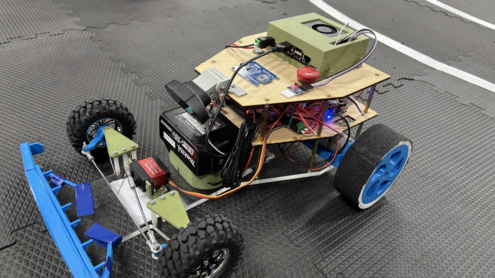
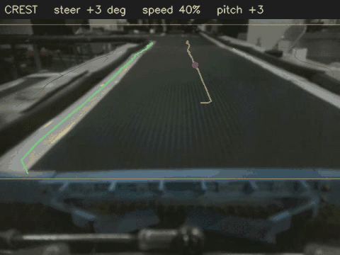
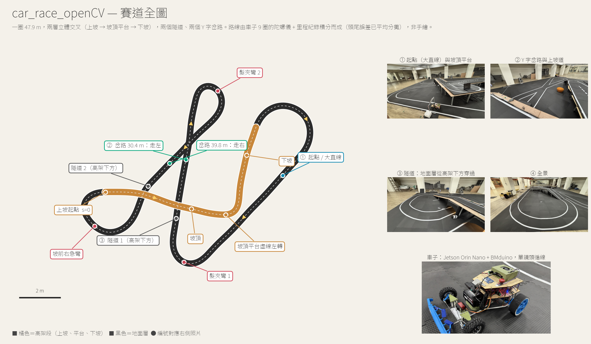

# car_race_openCV — 單鏡頭自主循線賽車

只靠**一顆鏡頭 + 一顆陀螺儀**，在有上坡、坡頂平台、下坡、隧道、Y 字岔路的立體賽道上自主連續跑圈。
運算在 Jetson Orin Nano 上用 Python + OpenCV 完成，透過 UART 指揮 BMduino 控制前輪舵機與後輪馬達。

<p align="center">
  
  
</p>
<p align="center"><sub>右：車上鏡頭實錄（坡頂 → 虛線左轉 → 平台出口 → 下坡），疊上程式辨識到的車道線與追蹤目標點</sub></p>

## 成果

| 項目 | 數字 |
|---|---|
| 最佳單圈 | **56.4 秒**（一圈 47.9 m，2026-11-23） |
| 圈速演進 | 87.8 s（10 月底，第一次連續兩圈）→ 約 59 s（11-22，背地圖）→ 56.4 s（11-23） |
| 賽道元素 | 上坡、坡頂平台虛線左轉、下坡、2 個隧道、2 個 Y 字岔路、2 個髮夾彎 |
| 主程式 | `orin_tools/drive/` 約 3,800 行 Python |

## 賽道



賽道圖不是手畫的：用車子 9 圈的陀螺儀 + 里程紀錄（[`track_map.json`](orin_tools/drive/track_map.json)，每 0.1 m 一筆車頭角）積分出實際行駛路線，
再標上路段（產生程式：[`docs/tools/make_track_map.py`](docs/tools/make_track_map.py)）。地面層從高架下方穿過兩次，就是兩個隧道。

## 硬體

| 部件 | 型號 / 說明 |
|---|---|
| 運算 | NVIDIA Jetson Orin Nano |
| 下位機 | BMduino（UART 115200，每 50 ms 收一次指令、回報狀態） |
| 鏡頭 | USB 鏡頭 640×480 @ 30 fps（處理時縮成 320×240） |
| 姿態 | MPU-6050（I2C）：俯仰判斷上下坡、陀螺儀算車頭角 |
| 驅動 | 前輪舵機轉向（±44°）＋後輪雙馬達（DRV1011，PCA9685 產生 PWM），可做後輪差速 |
| 電源 | 18 V 電動工具電池 |

接線與電路圖：[docs/硬體/](docs/硬體/)；通訊協議：[docs/設計/](docs/設計/)；BMduino 韌體：[firmware/](firmware/)。

## 系統架構

```
鏡頭 ─▶ perception.py ──────────┐
        車道線 → 地面座標 → 中線   │
        虛線 / V 岔路 / 暗處偵測    ▼
IMU ──▶ 俯仰、車頭角 ───────▶ driver.py ──▶ link.py ──UART──▶ BMduino ──▶ 舵機 / 馬達
                               ▲  方向：Pure Pursuit + Stanley
trackmap.py（背地圖定位）──────┘  速度：彎道 / 直線 / 坡道 / 暗處 規劃（漸進加減速）
        里程 + 陀螺儀比對地圖           路段：岔路、虛線左轉、坡道、平台出口
```

## 核心技術

**1. 影像循線（[perception.py](orin_tools/drive/perception.py)）**
二值化找白線 → 用鏡頭校正（地平線、鏡頭高度）把畫面座標換成地面座標 → 配對左右線、算出中線。
另外偵測前方橫越的虛線（路口）、Y 字岔路的 V 形分隔線、隧道暗處。

**2. 轉向控制（[driver.py](orin_tools/drive/driver.py)）**
Pure Pursuit 追中線上前方一段距離的點，再和 Stanley（車道方向 + 橫向偏移）各取一半；
直線上會自動學習前輪置中誤差與左右輪出力差。

**3. 背地圖定位（[trackmap.py](orin_tools/drive/trackmap.py)）**
一維直方圖濾波：用指令速度推算行駛距離，再拿「最近 1.5 m 陀螺儀轉了幾度」和地圖比對；
上坡起點、下坡起點、虛線、隧道→V 的地標序列可以直接把位置拉回來。定位確定後，地圖用來：
提早減速、決定岔路方向、在已知暗處先降速、在暗處 / 隧道 / 平台出口改用陀螺儀維持方向。

**4. 立體路段**
- 上坡：量出坡道方向後用陀螺儀維持直線，畫面不動（卡住）時漸進加推力。
- 坡頂平台：追蹤橫越虛線的距離，到 0.78 m 才左轉，轉到指定角度後回到循線。
- 平台出口 / 下坡：出口方向 = 左轉開始的車頭角 + 地圖量到的角度，影像只能小幅修正。

**5. 速度規劃**
依前方彎的程度、地圖曲率、坡道、暗處、岔路決定速度，平均速度與每個後輪指令都有每秒最大變化量限制（漸進加減速）。

## 開發方法：每個改動都用 log 證明

每跑一趟，車上會留下逐張紀錄（CSV：辨識結果、前輪角、輪速、俯仰、車頭角、地圖位置）和原始錄影。
問題都是從 log 找證據、改完用錄影**回放**驗證後才上車，參數旁邊的註解會寫明是哪一趟 log 的什麼數字。幾個例子：

| 問題 | 證據 | 解法 |
|---|---|---|
| 坡頂虛線左轉太晚，差點掉下平台 | 遠處虛線亮度低於門檻，0.65–0.82 m 才看到，比設定的 0.78 m 還近 | 門檻 150 → 110，回放顯示 1.5 m 就看得到、轉彎點回到 0.75–0.77 m |
| 平台出口車頭轉過頭、下坡衝出去 | 轉完後影像看錯又左打，車頭 +110°（地圖應為約 +75~85°） | 出口方向改照地圖，影像修正限制在 ±8° 內 |
| 大直線衝進暗處 | 同一個位置第一圈 44% 沒事、第二圈 59.6% 影像看錯衝出 | 地圖標記暗處，前方漸進降速（先降到 45%，之後每趟用 log 確認後逐步提高到 70%） |
| 暗處 / 隧道撞牆 | 影像方向 −67° ↔ +71° 亂跳，前輪跟著打 −31° | 暗處改用陀螺儀維持進去前的方向，回放最大左打 −31° → −11° |
| 岔路判錯 | 影像判斷 V 尖端的位置有 ±7 cm 雜訊，偏 4 cm 就判反 | 用「V 前面有沒有隧道」等地標認是哪個岔路 |

工具：[tools/replay.py](orin_tools/drive/tools/replay.py)（離線回放）、[tools/video_check.py](orin_tools/drive/tools/video_check.py)（錄影檢查）、
[tools/calibrate.py](orin_tools/drive/tools/calibrate.py) / [cam_align.py](orin_tools/drive/tools/cam_align.py)（鏡頭校正與對準）、[tools/log_tidy.py](orin_tools/drive/tools/log_tidy.py)（整理紀錄）。

## 資料夾

```
├── orin_tools/drive/      目前的主程式（背地圖版，車上實際執行）
│   ├── main.py / driver.py / perception.py / trackmap.py / camera.py / imu.py / link.py
│   ├── config.yaml        所有參數（附調整原因與 log 證據）
│   ├── track_map.json     賽道地圖
│   └── tools/             校正、回放、檢查、建地圖工具
├── orin_tools/lane/       上一代循線程式（10 月，參考用）
├── orin_snapshot/         各階段穩定版快照
├── firmware/              BMduino 韌體與診斷程式
├── docs/                  操作手冊、程式說明、接線、系統設計、賽道照片、賽道圖
└── 海報資料/              專題海報文字與圖片
```

## 執行

```bash
# 在 Orin 上
cd ~/orin_tools/drive
python3 webctl.py                       # 網頁控制台（手機開 http://<ORIN_IP>:8000/）
python3 main.py                         # 只開主程式：Enter 出發 / 停車
python3 tools/calibrate.py              # 鏡頭校正（車子擺在直線正中間）

# 在電腦上用錄影離線回放
python tools/replay.py ../logs/run_YYYYmmdd_HHMMSS.mp4
```

實跑紀錄（影片 + CSV）體積太大（數 GB），沒有放進 repo。
